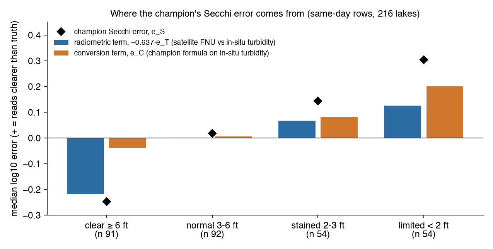
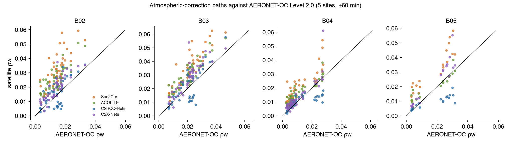
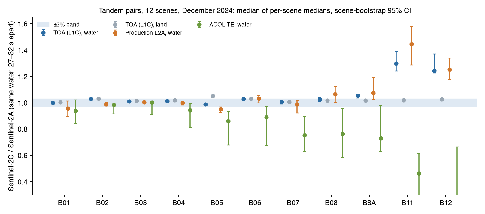
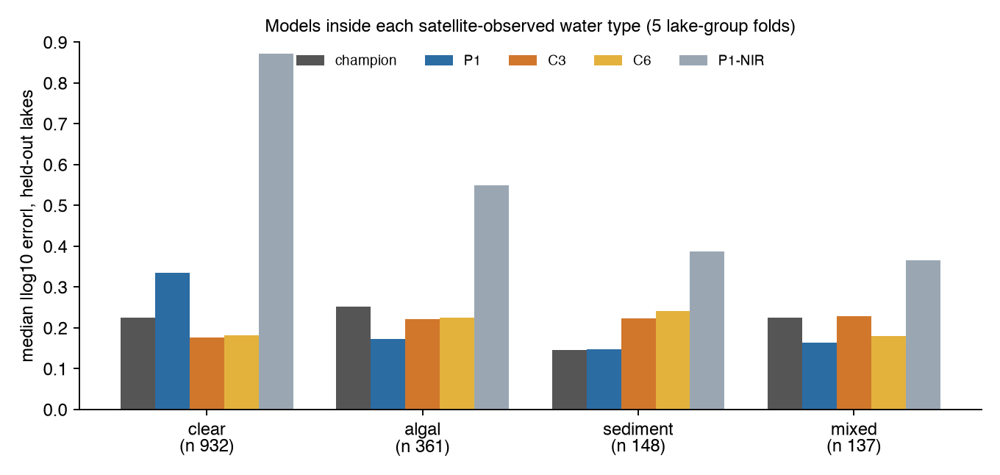

# Current Clarity Stage 11: Reflectance and Sensor Audit

**Diagnostic only.** Production Current Clarity is unchanged. The Stage 10 frozen models and the P2 fresh holdout are untouched, and no Sector field observation was used.

**Freeze.** The pre-registration was hashed at **2026-09-30T04:44:17Z** (sha256 `274320fa…`) before any Stage 11 error was computed. Two addenda were recorded before the data they govern existed (section 2).

## The answer

**Most of the remaining error comes from the satellite's reflectance, not the Secchi conversion.**
- **The radiometric term is 63% of the champion's error variance** (CI 54–71%).
- **Most of that is unexplained.** Aerosol, glint, adjacency, platform and water type together explain only a fifth of it. The unexplained remainder alone is 50% of all the variance. The unexplained conversion term is next, at 36%.
- **Measured water reflectance shows what the rest is.** Against AERONET-OC, Sen2Cor reads inland and coastal water too bright in every band tested: red ×1.9, blue ×2.2. A fixed brightening matters most in dark water, which fits the clear-water over-read.

**The other five questions:**
- **Atmospheric correction: ACOLITE, by the frozen rule.**
  - It is 25% closer to AERONET-OC than Sen2Cor (CI excludes 0) and no worse on in-situ turbidity.
  - C2RCC and C2X are closer still to AERONET-OC (55% and 50%), but they read inland turbidity 3–5× too low, so they fail the second test.
  - On the champion's own band (red), ACOLITE's gain is small: a bias of +0.25 against +0.28.
- **Sentinel-2C needs harmonisation: YES.**
  - A B05 band-shape shift and a B8A–B12 dark-water offset are present at top of atmosphere, 30 s after 2A.
  - They flip 15.5% of P2's routes on identical water. The red-band champion is unaffected.
- **Routing by water type: NO.**
  - The satellite classifier works (balanced accuracy 0.56), and a pattern exists: C3 for clear water, P1 for algal and mixed.
  - But routing gains only 7.4% over the best single model, below the 10% bar. C3 is never chosen for algal water.
- **A second sensor: NO.**
  - When Landsat agrees with Sentinel-2 the error is 24% lower, but the bar was 25% and the CI touches 0.
  - Fusing the two gains 7%, below the 10% bar.
  - OLCI reaches only 119 offshore stations, too few for the test.
- **Temporal consistency: NOT USEFUL.**
  - Flagged passes are 1.6× worse.
  - But replacing them with their neighbours' median helps only 7% (bar 20%).

## 1. What was tested

| | |
|---|---|
| Validation corpus | **1,631 agency station-days in 1,015 lakes and 42 states**, 2018–2025, each with a direct Sentinel-2 read (production gates, 60 m disk, ±1 day). Of these, 831 have same-day in-situ turbidity, 291 of them imaged the same day; 1,024 have same-day chlorophyll. |
| Corpus sources | Stage 7 national (640); Stage 8 national (400); new expansion (546: 363 national, 173 ADEM Alabama, 10 TDEC Tennessee); Guntersville re-read through the production collection (45) |
| Radiometric truth | AERONET-OC Level 2.0 at Lake Erie, Lake Okeechobee, Lake Vänern (Palgrunden), Chesapeake Bay and the Louisiana shelf (WaveCIS): **46 Sentinel-2 overpasses** (Erie 10, Okeechobee 10, Palgrunden 10, Chesapeake 9, WaveCIS 7), each within ±60 min of a Level 2.0 record |
| Atmospheric correction | Sen2Cor (production L2A); ACOLITE 20260421.0 (DSF, glint correction, no ancillary); SNAP 14.0.1 C2RCC-Nets and C2X-Nets. **POLYMER was not run** (section 2). |
| Tandem | 12 clear Sentinel-2A/2C pairs, 12–18 December 2024, 27–32 s apart, on four continents |
| Second sensors | Landsat 8/9 Collection 2 L2 (375 station-days in 301 lakes with a valid read within ±1 day); Sentinel-3 OLCI WFR L2 (119 of the 241 station-days at least 600 m from shore, in 98 lakes, with a valid read within ±1 day) |
| Held-out validation | 5 folds of whole lakes (sites joined within 5 km); nothing is ever evaluated on a lake it was fitted on |
| Not touched | Stage 10 fresh holdout: no field reports, no 2026 agency values, no fresh national draw. New national sites were chosen with no Secchi record on or after 2025-01-01, so none can enter the P2 fresh national pool. |
| Not changed | Champion, C3, C6, P1, P2, the NDCI warning, clarity feet, map hue, confidence, Huntability and Sector Intelligence |

## 2. Deviations and data decisions

The first two were recorded as addenda before the data they govern existed. The rest were found during the run, and each says what had been seen by then.

- **TVA publishes nothing to the Water Quality Portal.** The organisation search returns no TVA identifier in Tennessee or Alabama. Addendum B replaced it with TDEC, the Tennessee state agency, and noted that the pool starts in 2018.
- **P1-NIR's water absorption.** ACOLITE ships no pure-water absorption beyond the visible, so addendum A took a_w(783) = **2.62 m⁻¹** from Kou et al. (1993), band-averaged over B07. It was recorded before any P1-NIR value existed.
- **2026 rows dropped.** The Stage 7 and Stage 8 national sets carried 21 rows dated 2026. They were dropped to honour the pre-registered ≤ 2025-12-31 rule. They could not have overlapped the P2 fresh draw, which excludes sites in earlier files. Parts A, D and E were rerun without them.
- **POLYMER not run.** Its licence counts use as acceptance, limits use to non-commercial research, and requires confidentiality. That decision is yours, not mine. The source was cloned but never built or run.
- **C2RCC configuration.** Salinity was set per site (0.1 PSU for lakes; nominal values for the estuaries and the shelf) and temperature to 20 °C. The embedded-ECMWF option was switched off after the first crashes, so every run uses SNAP's constant ozone and pressure.
- **C2RCC crashes.** About half the scenes first crashed SNAP in native code. The crash is in the NetCDF4-CF writer: libnetcdf segfaults while it writes the product's metadata groups (`nc_def_grp`), and whether it happens depends on the scene. Switching glibc off its AVX code paths moved the crash but did not stop it. Every crashed scene was rerun with SNAP's NetCDF4-BEAM writer, which stores the same bands. On a scene that runs under both writers, every sampled value is bit-identical. So these crashes are tooling failures and are not counted against C2RCC's valid-retrieval rate.
- **ACOLITE caveat.** It runs through a small stand-in for GDAL's Python bindings, which cannot be installed here. The stand-in calls the real GDAL library, and it matched raw top-of-atmosphere values.
- **Guntersville.** Only 45 of the 87 historical Guntersville rows have a valid production-collection pass. The rest came from an older collection.
- **Representative scenes, reselected once.** The first selector skipped the ≤ 2025 rule, so 3 of its 13 scenes were 2026 rows that scoring drops. That left no scored "normal" scene. It also let two classes that chose the same scene overwrite each other. Both bugs were fixed and the same frozen rule was rerun, giving 15 scenes. Some preliminary metric-2 numbers had been seen by then, but the selection rule itself was not changed.
- **AERONET-OC job names.** Four overpasses fall on two tiles each, and each pair shared a job name. The processors ran on the first tile, so scoring now uses that tile's Sen2Cor values too. The second tile is the same datatake and time.
- **OLCI units.** OLCI reports suspended matter in g/m³, not FNU. For the agreement test the median TSM/FNU ratio is removed first; this was not specified in advance.
- **Metric 4** (plausibility) is reported for AERONET-OC matchups only.

## 3. Part A: where the champion's error comes from

For the champion, Ŝ = 11.123 · FNU^−0.637, the log error splits **exactly** into two terms:
- **e_T (radiometric and retrieval):** the satellite's turbidity (FNU) against in-situ turbidity measured the same day.
- **e_C (conversion):** the champion's own formula applied to that in-situ turbidity, against Secchi.

The identity is e_S = −0.637·e_T + e_C, and it holds to 6 decimals.

| | Same-day satellite pass (primary) | Satellite ±1 day |
|---|---:|---:|
| Rows / lakes | 291 / 216 | 831 / 478 |
| Var(e_S), log10² | 0.105 | 0.098 |
| Radiometric share of Var(e_S) | **63%** (lake-bootstrap 95% CI 54%–71%) | 59% |
| Conversion share of Var(e_S) | **37%** | 41% |
| Median \|e_S\| (champion) | 0.188 (×1.54) | 0.187 |
| … if satellite turbidity were perfect (conversion only) | 0.133 (×1.36) | 0.121 |
| … if the conversion were perfect (radiometry only) | 0.153 (×1.42) | 0.137 |
| Median \|e_T\| (satellite FNU vs in-situ turbidity) | 0.240 (×1.74) | 0.216 |

**The radiometric side carries about two-thirds of the error.** Making the satellite's turbidity perfect would shrink the typical Secchi error from ×1.54 to ×1.36. Making the conversion perfect would shrink it to ×1.42.

**By Secchi class the two sides behave very differently:**

| Secchi class | Rows (lakes) | Median e_T | Radiometric term (−0.637·e_T) | Conversion term e_C | Champion e_S |
|---|---:|---:|---:|---:|---:|
| Clear ≥ 6 ft | 91 (70) | +0.342 (×2.20) | -0.218 | -0.040 | -0.247 |
| Normal 3–6 ft | 92 (73) | -0.002 (×1.00) | +0.001 | +0.006 | +0.017 |
| Stained 2–3 ft | 54 (49) | -0.105 (×0.79) | +0.067 | +0.081 | +0.144 |
| Limited < 2 ft | 54 (49) | -0.196 (×0.64) | +0.125 | +0.201 | +0.304 |

- **In clear water (≥ 6 ft) the error is almost entirely radiometric.** The satellite reads turbidity 2.2× too high, so the champion under-reads clarity. The conversion is right there.
- **In murky water both sides push the same way.** The satellite reads turbidity too low, and the formula converts it to too much clarity.

**What the satellite-observable blocks explain** (lake-held-out Shapley R²):

| Block (satellite-observable) | Explains of e_T (held-out R²) | Explains of e_C (held-out R²) |
|---|---:|---:|
| AC/aerosol | +0.022 | -0.000 |
| glint | +0.057 | -0.001 |
| adjacency | +0.059 | -0.017 |
| platform | -0.012 | +0.009 |
| water type | +0.079 | +0.023 |
| **All blocks together** | **+0.205** | **+0.014** |

**Attribution of Var(e_S)**, by the frozen rule:

| Source (block) | Share of Var(e_S) |
|---|---:|
| radiometric: unexplained (match-up, instrument, residual) | 50% |
| conversion: unexplained (Secchi-turbidity scatter, CDOM, algae not typed) | 36% |
| radiometric: water type | 5% |
| radiometric: adjacency | 4% |
| radiometric: glint | 4% |
| radiometric: AC/aerosol | 1% |
| conversion: water type | 1% |
| conversion: other blocks | 0% |
| radiometric: platform | 0% |

- **The named blocks explain little.** Aerosol, glint, adjacency, platform and water type together explain only 21% of the radiometric term and 1% of the conversion term. Platform explains nothing, because the same-day rows with turbidity contain no Sentinel-2C.
- **The frozen rule's primary source is the rest of the radiometric term.** That is 50% of the variance, against 36% for the unexplained part of the conversion.
- **What that bucket holds** is atmospheric-correction error that aerosol optical depth does not capture, plus station-versus-pixel mismatch and instrument differences. Part B measures the atmospheric-correction share directly.

**The conversion is close to its floor.** A lake-held-out refit on the same in-situ turbidity does no better than the champion's formula, and adding chlorophyll barely helps:

| Conversion (in-situ inputs) | Rows | Median \|log error\| (held-out lakes) | Champion formula, same rows |
|---|---:|---:|---:|
| Refit on in-situ turbidity | 291 | 0.150 | 0.133 |
| Refit on in-situ turbidity + chlorophyll | 246 | 0.141 | 0.121 |

**An exploratory check** (not pre-registered; no verdict uses it). Is the clear-water over-read an additive offset? Subtracting each pixel's own B11 from B04 before the turbidity step gives this:
- **The clear-water bias disappears.** The turbidity bias goes from +0.34 to −0.06 and the Secchi bias from −0.25 to +0.03.
- **The clear-water error barely moves** (0.256 to 0.248).
- **Every murkier class gets worse.** For example, normal water goes from 0.10 to 0.20.

So the clear-water over-read behaves like an offset about B11's size (0.006 in reflectance), but B11 cannot estimate that offset pixel by pixel. That matches what Part B measures directly: Sen2Cor leaves inland water too bright.

## 4. Part B: which atmospheric correction

### Against measured water reflectance (AERONET-OC)

Each cell reads median |log10 error| (median log bias), n.

| Processor | Valid | B02 | B03 | B04 | B05 | B02–B05 median \|log\| |
|---|---:|---|---|---|---|---:|
| Sen2Cor (production) | 100% | 0.34 (+0.34), n 46 | 0.20 (+0.20), n 46 | 0.28 (+0.28), n 46 | 0.29 (+0.29), n 20 | **0.280** |
| ACOLITE (own mask) | 96% | 0.27 (+0.27), n 44 | 0.17 (+0.17), n 44 | 0.25 (+0.25), n 44 | 0.11 (+0.11), n 18 | **0.210** |
| ACOLITE (water/cloud mask) | 96% | 0.27 (+0.27), n 44 | 0.17 (+0.17), n 44 | 0.25 (+0.25), n 44 | 0.11 (+0.11), n 18 | **0.210** |
| C2RCC-Nets | 98% | 0.19 (+0.08), n 45 | 0.11 (+0.06), n 45 | 0.10 (+0.04), n 45 | 0.19 (-0.19), n 19 | **0.125** |
| C2X-Nets | 98% | 0.16 (+0.16), n 45 | 0.12 (+0.12), n 45 | 0.11 (+0.10), n 45 | 0.15 (+0.15), n 19 | **0.139** |

**By site** (B02–B05 median |log10 error|):

| Processor | Lake Erie | Okeechobee | Vänern (Palgrunden) | Chesapeake Bay | WaveCIS (shelf) |
|---|---:|---:|---:|---:|---:|
| Sen2Cor (production) | 0.34 | 0.19 | 0.35 | 0.23 | 0.37 |
| ACOLITE (own mask) | 0.21 | 0.05 | 0.33 | 0.24 | 0.26 |
| ACOLITE (water/cloud mask) | 0.21 | 0.05 | 0.33 | 0.24 | 0.25 |
| C2RCC-Nets | 0.07 | 0.30 | 0.11 | 0.08 | 0.17 |
| C2X-Nets | 0.16 | 0.12 | 0.25 | 0.08 | 0.15 |

**Paired against Sen2Cor** on the same matchups and bands:

| Processor vs Sen2Cor (same matchup-bands) | Pairs (matchups) | Processor | Sen2Cor | Relative improvement | Difference 95% CI |
|---|---:|---:|---:|---:|---|
| ACOLITE (own mask) | 150 (44) | 0.210 | 0.280 | +25% | -0.103 to -0.025 |
| ACOLITE (water/cloud mask) | 150 (44) | 0.210 | 0.280 | +25% | -0.103 to -0.025 |
| C2RCC-Nets | 154 (45) | 0.125 | 0.279 | +55% | -0.196 to -0.059 |
| C2X-Nets | 154 (45) | 0.139 | 0.279 | +50% | -0.174 to -0.094 |

**Plausibility** (metric 4), on the same matchups:

| Processor | ρw values (B02–B05) | Share ≤ 0 | Median ρw(B11) |
|---|---:|---:|---:|
| Sen2Cor (production) | 184 | 0.0% | 0.0038 |
| ACOLITE (own mask) | 176 | 0.0% | 0.0000 |
| ACOLITE (water/cloud mask) | 176 | 0.0% | 0.0000 |
| C2RCC-Nets | 180 | 0.0% | not reported |
| C2X-Nets | 180 | 0.0% | not reported |

**What the measured reflectance shows:**
- **Sen2Cor reads water too bright in every band tested.** The median bias is +0.34 in blue, +0.20 in green, +0.28 in red and +0.29 at 704 nm (×2.2, ×1.6, ×1.9 and ×1.9).
  - Dark water is where a fixed additive error matters most, which is exactly where Part A finds the clear-water over-read.
  - Sen2Cor is a land correction. It does not remove sky light reflected at the water surface, and it leaves 0.0038 in B11, where water is black.
- **ACOLITE removes part of it.** Its B11 falls to 0, and its 704 nm band improves most (bias +0.11 against +0.29).
  - But its red band stays nearly as bright (+0.25), and red is the only band the champion reads.
  - It ran with ACOLITE's default of not modelling reflection at the air–water interface (`dsf_interface_reflectance=False`). That is a plausible cause of the remaining offset, and the first thing to test next.
- **C2RCC and C2X come closest overall** (0.125 and 0.139, against 0.280 for Sen2Cor), and C2RCC's red band is almost unbiased (+0.04). Their valid rate is 98%.
  - C2RCC reads 704 nm too dark (−0.19).
  - It is worst at Lake Okeechobee, the most turbid lake site (0.30).
- **By site:** ACOLITE is best at Okeechobee (0.05) and C2RCC at Erie (0.07). No processor is best everywhere.
- **Criterion (a) (≥ 20% better than Sen2Cor, CI excluding 0) is met by all three:**
  - ACOLITE, 25%;
  - C2X, 50%;
  - C2RCC, 55%.
- **Plausibility:** no processor returns a non-positive ρw in B02–B05 at these sites.

### Against in-situ turbidity and Secchi (representative corpus scenes)

| Processor | Stations valid | Median \|e_T\| (FNU vs in-situ turbidity) | Median e_T | Champion formula median \|log\| | P1 answers | P1 median \|log\| |
|---|---:|---:|---:|---:|---:|---:|
| Sen2Cor (production) | 20 | 0.445 | -0.334 | 0.269 | 16 | 0.11 |
| ACOLITE (own mask) | 18 | 0.375 | -0.337 | 0.245 | 16 | 0.098 |
| ACOLITE (water/cloud mask) | 18 | 0.375 | -0.337 | 0.245 | 16 | 0.098 |
| C2RCC-Nets | 20 | 0.684 | -0.684 | 0.44 | 11 | 0.228 |
| C2X-Nets | 20 | 0.5 | -0.5 | 0.361 | 14 | 0.139 |

**Criterion (b), paired on the stations both processors answer:**

| Processor vs Sen2Cor (stations both answer) | Stations | Processor median \|e_T\| | Sen2Cor median \|e_T\| | Stations where the processor is closer |
|---|---:|---:|---:|---:|
| ACOLITE (own mask) | 18 | 0.375 | 0.425 | 7 of 18 |
| ACOLITE (water/cloud mask) | 18 | 0.375 | 0.425 | 7 of 18 |
| C2RCC-Nets | 20 | 0.684 | 0.445 | 2 of 20 |
| C2X-Nets | 20 | 0.5 | 0.445 | 5 of 20 |

**Criterion (b), in-situ turbidity, decides it:**
- **ACOLITE is not worse than Sen2Cor.** Its median |e_T| is 0.375 against 0.425 on the 18 stations both answer.
  - It is closer on only 7 of the 18, so the margin is thin.
  - Downstream it also edges Sen2Cor: the champion's formula 0.245 against 0.269, and P1 0.098 against 0.110 (16 answers each).
- **C2RCC and C2X are worse**, at 0.684 and 0.500 against 0.445 on 20 stations.
  - Both read turbidity too low in every class, clear water included (medians ×4.8 and ×3.2 too low).
  - Their neural networks, closest to AERONET-OC at moderate turbidity, read inland red reflectance too dark. The AERONET-OC scatter shows the same thing above ρw ≈ 0.02.
- **Every processor under-reads these murky scenes.** Sen2Cor's median e_T is −0.33, as is ACOLITE's. Only 15 scenes and 20 stations back this test.

**Best path by the frozen rule: ACOLITE.** It is the only processor that meets both (a) and (b). C2RCC and C2X meet (a) by a wider margin but fail (b).

## 5. Part C: Sentinel-2A against Sentinel-2C over the same water

| Band | TOA water C/A | TOA land C/A | TOA water C − A | Production L2A water C/A | ACOLITE water C/A |
|---|---:|---:|---:|---:|---:|
| B01 | 1.000 (0.993–1.010) | 1.005 (0.998–1.012) | +0.0000 (-0.0010–+0.0015) | 0.956 (0.898–1.014) | 0.939 (0.843–1.022) |
| B02 | 1.029 (1.026–1.034) | 1.032 (1.029–1.036) | +0.0033 (+0.0030–+0.0035) | 0.989 (0.975–1.004) | 0.984 (0.916–0.991) |
| B03 | 1.011 (1.010–1.014) | 1.016 (1.015–1.017) | +0.0008 (+0.0007–+0.0017) | 1.003 (0.999–1.012) | 1.002 (0.909–1.010) |
| B04 | 1.013 (1.009–1.015) | 1.020 (1.017–1.021) | +0.0007 (+0.0003–+0.0012) | 1.000 (0.984–1.008) | 0.942 (0.813–0.995) |
| B05 | 0.989 (0.983–0.996) | 1.051 (1.040–1.066) | -0.0005 (-0.0009–-0.0002) | 0.953 (0.925–0.969) | 0.860 (0.678–0.934) |
| B06 | 1.028 (1.025–1.035) | 1.031 (1.027–1.033) | +0.0011 (+0.0006–+0.0014) | 1.031 (0.999–1.057) | 0.891 (0.673–0.970) |
| B07 | 1.006 (0.990–1.014) | 1.006 (1.005–1.008) | +0.0003 (-0.0002–+0.0005) | 0.988 (0.922–1.018) | 0.753 (0.629–0.897) |
| B08 | 1.027 (1.011–1.042) | 1.017 (1.016–1.019) | +0.0005 (+0.0004–+0.0012) | 1.065 (1.005–1.122) | 0.762 (0.586–0.955) |
| B8A | 1.055 (1.036–1.062) | 1.017 (1.016–1.018) | +0.0012 (+0.0008–+0.0016) | 1.076 (1.026–1.193) | 0.730 (0.628–0.982) |
| B11 | 1.298 (1.242–1.392) | 1.021 (1.012–1.024) | +0.0019 (+0.0014–+0.0033) | 1.446 (1.287–1.577) | 0.463 (0.000–0.613) |
| B12 | 1.244 (1.225–1.372) | 1.027 (1.016–1.030) | +0.0012 (+0.0008–+0.0020) | 1.253 (1.177–1.339) | 0.168 (0.000–0.664) |

**Reading the bands:**
- **Visible B02–B04: a calibration difference, absorbed by the time it reaches production.** In the commissioning products 2C reads 1–3% brighter over both water and land, a gain difference. The production L2A (from the 2026 operational reprocessing) agrees within about 1%.
  - Either the reprocessing corrected the gain, or the atmospheric correction absorbed it. These data cannot tell which, because the reprocessed 2C top-of-atmosphere products are not publicly mirrored.
- **B05: a band-shape difference, still present.** 2C reads 1% darker over water but 5% brighter over land. That is the signature of a red-edge band centred about 3 nm longer (707 against 704 nm), since water reflectance falls steeply there and vegetation's rises. Production L2A carries it through as **4.7% darker water** (CI 3.1–7.5%).
- **B8A, B11 and B12: an additive offset over dark water, still present.** Over water 2C reads +0.001–0.002 in reflectance above 2A, while over land the ratio is only +2%. Production L2A shows it as **B11 45% higher** over water (0.0060 against 0.0043). Noise is not the cause: 2C's local B11 noise is lower.
- **ACOLITE amplifies the difference.** The shortwave-infrared offset raises the dark spectrum, which inflates the aerosol estimate. In clear water ACOLITE's 2C output drops by 14% in B05 and up to 60% in some scenes.

**Downstream, pixel by pixel over the tandem water:**

| Downstream, pixel by pixel over tandem water | S2A | S2C | Difference / flip |
|---|---:|---:|---:|
| P2 sends the pixel to P1 | 28.1% (8.5%–71.5%) | 5.6% (0.4%–36.6%) | route flips: **15.5% (4.5%–32.4%)** |
| P2 residual sensitivity S (limit 0.20) | 0.174 (0.129–0.435) | 0.256 (0.200–0.728) | |
| P1 answers | 97.3% (86.1%–99.9%) | 91.3% (83.2%–99.9%) | |
| Champion (production) Secchi, C − A | | | **-0.001 (-0.017–+0.040) ft** |
| C3, C − A | | | +0.029 (-0.005–+0.113) ft |
| P1, C − A | | | +0.128 (+0.048–+0.379) ft |
| P2, C − A | | | +0.140 (+0.045–+0.863) ft |

| Production L2A B11 over water (20 m) | S2A 0.0043 | S2C 0.0060 |
|---|---:|---:|
| B11 local 3×3 standard deviation (noise) | 0.0004 | 0.0003 |

**Per pair:**

| Water, tile | Pixels | P2 route flips | Champion Δft | C3 Δft | P2 → P1 share (A / C) |
|---|---:|---:|---:|---:|---:|
| Lake Pontchartrain US 15RYP | 4000 | 19% | +0.00 | +0.00 | 62% / 45% |
| Lake Pontchartrain US 16RBU | 4000 | 55% | +0.11 | +0.13 | 75% / 28% |
| Mobile Bay US 16RCU | 4000 | 39% | +0.02 | +0.03 | 41% / 7% |
| Mobile Bay US 16RDU | 4000 | 26% | -0.14 | -0.15 | 15% / 6% |
| Tampa Bay US 17RLL | 4000 | 6% | +0.15 | +0.18 | 5% / 2% |
| Lake Kariba ZW 35KNB | 4000 | 0% | -0.02 | +2.22 | 0% / 0% |
| Lake Kariba ZW 35KPB | 4000 | 0% | -0.02 | +0.09 | 0% / 0% |
| Lake Volta GH 30NZP | 4000 | 12% | +0.02 | +0.03 | 12% / 1% |
| Lake Van TR 38SLH | 4000 | 20% | +0.06 | +0.07 | 14% / 5% |
| Lake Nasser south SD 36QUJ | 4000 | 100% | -0.01 | -0.01 | 100% / 0% |
| Lake Chapala MX 13QFC | 4000 | 3% | -0.00 | -0.00 | 85% / 88% |
| Lake Chapala MX 13QGC | 4000 | 8% | -0.01 | -0.01 | 68% / 75% |

**What caused the Stage 10 S2C routing pattern:**
- **Sensor: yes.** The B05 band shape and the B8A–B12 dark-water offset are present at top of atmosphere, 30 s apart under the same atmosphere.
- **Processing baseline: not the cause.** The B05 and shortwave-infrared differences persist in the 2026 operational reprocessing.
- **Atmospheric correction: it amplifies.** Sen2Cor turns B05's −1% at top of atmosphere into −4.7%. ACOLITE turns it into −14%.
- **Downstream logic: that's where it bites.** P2's residual test reads B11 as "image residual". 2C's 0.0017 B11 offset lifts P2's median S from 0.17 to 0.26, across its 0.20 limit. So P2 abandons P1 on 2C (28% of water to P1 on 2A, 6% on 2C), and a median 15.5% of routes flip on identical water.
- **The production champion is unaffected.** It reads only B04, which agrees; the median change is −0.001 ft.

**Harmonisation: YES by the frozen rule.** B05 falls outside ±3% and B11 differs by more than 0.001 (condition a), and routes flip more than 10% (condition b). Harmonisation matters for anything that reads B05 (NDCI, P1's 704 nm reference, C3's branch) or B11 (P2), not for the red-band champion.

## 6. Part D: an optical-water-type classifier from the satellite alone

The rules were fixed in advance, with no lake identity: unsupported if implausible, then NDCI > 0.03 for algal, FNU ≥ 8 for sediment, both for mixed, and clear otherwise. The classifier was scored against in-situ types from same-day chlorophyll and turbidity, on 711 rows in 418 lakes.

| In-situ ↓ / satellite → | clear | algal | sediment | mixed | unsupported | Recall |
|---|---:|---:|---:|---:|---:|---:|
| **clear** | 292 | 39 | 21 | 4 | 9 | 0.80 |
| **algal** | 52 | 64 | 4 | 10 | 1 | 0.49 |
| **sediment** | 15 | 8 | 56 | 13 | 3 | 0.59 |
| **mixed** | 9 | 46 | 15 | 45 | 5 | 0.38 |
| **Precision** | 0.79 | 0.41 | 0.58 | 0.62 | | |

- **Balanced accuracy: 0.56** (lake-bootstrap 95% CI 0.52–0.60), against 0.25 for a constant guess.
- **By class:**
  - clear is recognised well (0.80 recall, 0.79 precision);
  - sediment reasonably (0.59 recall);
  - algal only moderately (0.49 recall; 40% of in-situ algal water looks clear to NDCI);
  - mixed weakly (0.38 recall; it is most often read as algal, 38%).
- **Unsupported:** only 2.5% of rows.
- **Verdict: USEFUL**, by the frozen bar (balanced accuracy ≥ 0.50, recall ≥ 0.40 for clear, algal and sediment).

## 7. Part E: which model inside each water type (held-out lakes)

Each cell reads median |log10 error| / median signed error / class accuracy. C3 and C6 are refitted on training lakes only, in every fold.

| Satellite water type (rows) | champion | P1 | P1-NIR | C3 | C6 |
|---|---|---|---|---|---|
| clear (932) | 0.225 / -2.68 ft / 0.51 | 0.335 / -4.34 ft / 0.26 (93% answered) | 0.872 / -6.96 ft / 0.03 (78% answered) | 0.177 / -0.99 ft / 0.64 | 0.181 / -1.03 ft / 0.63 |
| algal (361) | 0.252 / +1.16 ft / 0.33 | 0.172 / -0.86 ft / 0.33 (72% answered) | 0.550 / -2.28 ft / 0.14 (65% answered) | 0.221 / +0.81 ft / 0.33 | 0.226 / +0.82 ft / 0.37 |
| sediment (148) | 0.146 / -0.63 ft / 0.34 | 0.147 / -0.71 ft / 0.34 (97% answered) | 0.388 / -1.56 ft / 0.28 (83% answered) | 0.224 / +0.92 ft / 0.28 | 0.242 / +1.08 ft / 0.24 |
| mixed (137) | 0.225 / +0.57 ft / 0.37 | 0.164 / -0.41 ft / 0.46 (66% answered) | 0.365 / -1.00 ft / 0.52 (50% answered) | 0.228 / +0.60 ft / 0.36 | 0.180 / +0.39 ft / 0.58 |
| unsupported (53) | 0.271 / +1.02 ft / 0.58 | 0.390 / -2.81 ft / 0.00 (21% answered) | 0.868 / -4.55 ft / 0.00 (21% answered) | 0.313 / +1.60 ft / 0.53 | 0.285 / +3.02 ft / 0.55 |
| **All** | 0.225 / -0.73 ft / 0.45 | 0.269 / -2.53 ft / 0.29 (84% answered) | 0.711 / -4.33 ft / 0.11 (72% answered) | 0.195 / +0.22 ft / 0.51 | 0.194 / +0.22 ft / 0.53 |

- **Clear water:** C3 wins, cutting the champion's clear-water error by 21% and its under-read from −2.7 to −1.0 ft. P1 under-reads clear water by 4.3 ft.
- **Algal water:** P1 wins clearly (0.17 against 0.22 for C3). **C3 is never chosen for algal water.**
- **Mixed water:** P1 wins (0.16), with C6 next.
- **Sediment water:** the champion and P1 tie (0.146 against 0.147), and both beat C3 and C6.
- **P1-NIR, the new 783 nm variant, fails everywhere** (median error ×5). Sen2Cor's B07 over water is dominated by atmospheric-correction residual, so the physical reference does not hold. It is rejected.

**Nested routing** (the inner lake-folds choose each state's model; a state refuses if its best model's median error exceeds 0.25):

| Fold | clear | algal | sediment | mixed | unsupported |
|---|---|---|---|---|---|
| 0 | C3 | P1 | P1 | P1 | champion |
| 1 | C3 | P1 | P1 | P1 | refuse |
| 2 | C3 | P1 | P1 | P1 | refuse |
| 3 | C3 | P1 | champion | P1 | refuse |
| 4 | C3 | P1 | champion | P1 | refuse |

| | Routed (nested) | Best single model (C6) |
|---|---:|---:|
| Median \|log error\|, same rows | 0.174 | 0.188 |
| Difference (lake-bootstrap 95% CI) | -0.014 (-0.025 to -0.003) | |
| Relative improvement | 7.4% (bar: ≥ 10%) | |
| Coverage (answered) | 88% (bar: ≥ 70%) | 100% |
| Median signed error; class accuracy | -0.80 ft; 0.54 | +0.22 ft; 0.53 |

**Routing supported: NO by the frozen rule.**
- **The gain is real but small.** Routing beats the best single model by 7.4%, and the confidence interval excludes zero, but the bar was 10%.
- **The choices are stable except one tie.** The clear, algal and mixed choices are the same in all 5 folds. Sediment flips between two models that are practically tied.
- **What it means:** a regime pattern exists (C3 for clear water, P1 for algal and mixed water), but on this evidence routing buys too little to justify its complexity.

## 8. Part F: a second sensor

| Landsat 8/9 (±1 day) | Value |
|---|---|
| Rows with a valid read (lakes) | 375 (301) |
| S2 vs Landsat FNU, median log ratio (median \|log\|) | -0.030 (0.157); rank correlation 0.73 |
| Sensors agree (\|log ratio\| ≤ 0.15): median \|e_S\| | 0.165 (n 179) |
| Sensors disagree: median \|e_S\| | 0.217 (n 196) |
| Agree − disagree, 95% CI | [-0.096, 0.0] (relative reduction 0.241) |
| S2 alone / Landsat alone / fused: median \|e_S\| | 0.191 / 0.205 / 0.177 (fused − S2 CI [-0.041, 0.002]) |
| Against in-situ turbidity: S2 / Landsat / fused median \|e_T\| | 0.193 / 0.218 / 0.204 (n 201) |

| Sentinel-3 OLCI WFR (stations ≥ 600 m from shore, ±1 day) | Value |
|---|---|
| Rows attempted / with a valid read (lakes) | 241 / 119 (98) |
| TSM_NN vs S2 FNU: median log ratio (p10–p90) | +0.191 (-0.92 to +0.79) |
| Agree / disagree: median \|e_S\| | 0.276 (n 23) / 0.299 (n 96) |
| Rank correlation with in-situ turbidity: OLCI TSM / S2 FNU | 0.818 / 0.675 (n 58) |

**Multi-sensor fusion worth pursuing: NO by the frozen rule.**
- **Landsat: a narrow miss on both tests.**
  - When the two sensors agree, the error is 24.1% lower. The bar was 25%, and the CI's upper end sits at 0.000, so it does not exclude 0.
  - The S2+Landsat mean lowers the error by 7.3% (bar 10%), and its CI includes 0.
  - Against in-situ turbidity the fused value is worse than Sentinel-2 alone (0.204 against 0.193), so the fused Secchi gain is not a better turbidity.
  - Landsat on its own is worse than Sentinel-2 (0.205 against 0.191).
- **OLCI: too few stations to test.**
  - Only 119 station-days are far enough from shore for its 300 m pixels, and only 23 of those agree with Sentinel-2. Test (i) needs 30 on each side.
  - One exploratory hint: OLCI's neural-network suspended matter ranks in-situ turbidity better than Sentinel-2's FNU (rank correlation 0.82 against 0.68, n 58). It needs open water, so it cannot serve the bank-side stations bowfishers fish.
- **What it means:** agreement between sensors is a weak confidence signal, not a correction. It is not worth building ahead of the atmospheric-correction work.

## 9. Part G: temporal consistency across passes

| Temporal consistency (passes within ±10 days) | Value |
|---|---|
| Rows with ≥ 2 other passes | 779 |
| Flagged as radiometric outliers | 84 (0.108) |
| Median \|e_S\|: flagged / unflagged | 0.346 / 0.216 (ratio 1.6) |
| Flagged, after replacing with the neighbours' median | 0.321 (-7%) |
| Exploratory: refusing flagged passes instead (all rows) | 0.231 → 0.216 (-6%), keeping 89% of rows |

**Temporal consistency: NOT USEFUL by the frozen rule.**
- **The screen finds bad passes.** 10.8% of rows are outliers against their neighbours, and they are 1.6× worse (bar 1.5×).
- **It cannot fix them.** Replacing a flagged value with its neighbours' median helps only 7% (bar 20%). The neighbours mostly share the same error, which suggests a station-level bias that persists from pass to pass rather than pass noise.
- **Refusing flagged passes instead** (exploratory) lowers the overall error by 6% while keeping 89% of rows. That is too small to justify a gate on its own.
- **An early read on half the data looked useful** (37 flagged rows, a 24% reduction). The full data does not bear it out, and the verdict uses the full data.

## 10. The path to 9/10

**Readiness stays at 2/10.** Under the Stage 10 rubric only fresh held-out evidence moves a capability, and none exists yet.

**What Stage 11 changes about what to build**, in order:

| Step | The Stage 11 finding it rests on | Capabilities it serves | The evidence that would move the score |
|---|---|---|---|
| 1. Score P2's fresh validation exactly as frozen | Nothing here changes P2 | Clear and stained first. Historically P2 already clears the clear-channel PARTIAL bar | The Stage 10 fresh bars, unchanged |
| 2. Harmonise Sentinel-2C before anything that reads B05 or B11 ships | Part C: a B05 band-shape shift and a B8A–B12 dark-water offset at top of atmosphere; 15.5% of P2's routes flip on identical water | Algae (NDCI, P1), and clear and stained through P2's residual test | A correction frozen from the tandem, then route flips on the tandem water below 5% |
| 3. Move the reflectance to ACOLITE, testing its interface-reflectance term first | Part A: the unexplained radiometric term is the largest source (50%). Part B: ACOLITE passes both tests, but its red band is still +0.25 too bright | Clear first, where the error is almost all radiometric; then stained and limited | A pre-registered, lake-held-out rerun of the whole corpus (1,343 scenes) on ACOLITE reflectance, then the same fresh bars |
| 4. One model, not routing, and never C3 in algal water | Part E: routing gains 7.4% (bar 10%), and P1 beats C3 in algal water in every fold | Algae | The algae SUPPORTED bar: PPV ≥ 0.40 and \|median signed\| ≤ 1.0 in algal water |
| 5. Collect the fresh Secchi-grade data | The Stage 10 per-class minima | All six water capabilities | At least 215 fresh observations across warm and cool seasons: clear 40, normal 40, stained 60 in 6 arms, algae 30, sediment 20, limited 25 |

**What 9/10 means under the rubric.** Clear, normal, stained, algae, sediment and badly limited must all reach SUPPORTED on fresh data: 6.0 of 7, which rounds to 9. Bottom-risk stays NOT until a depth layer exists (the pending Navionics track).

**What Stage 11 rules out as near-term levers:**
- C2RCC and C2X for inland turbidity;
- routing by optical water type;
- P1-NIR;
- a second sensor (Landsat or OLCI);
- a temporal-consistency screen;
- the public-depth correction (frozen in Depth Stage 2).

**Cost.** Step 3 needs ACOLITE on 1,343 L1C scenes, roughly 70–90 hours on this Mac or a few hours as a cloud batch job. A cloud job would be a new cloud resource, so it waits for your go-ahead.

## Files

Everything is in `scratchpad/stage11/`:

| Path | Contents |
|---|---|
| `PREREGISTRATION_STAGE11.md`, `FREEZE_STAGE11.json` | The frozen plan and its addenda |
| `corpus/` | Draw, readouts, `corpus.json` (1,652 rows, 21 of them dropped at analysis), `sample_plus.py` |
| `tandem/` | `tandem.py`, `tandem_results.json`, `tandem_summary.json` |
| `ac/` | Processor driver, AERONET-OC matchups and results, representative scenes |
| `multisensor/` | Landsat and OLCI readers and results |
| `temporal/` | Every pass within ±10 days |
| `analysis/` | `part_a/b/de/fg` scripts and JSON, figures, tables |
| `tools/` | The SAFE fetcher, ACOLITE setup, SNAP C2RCC Docker setup, water-absorption tables |

---

PRIMARY REMAINING ERROR SOURCE: Radiometric: the satellite's water reflectance, not the Secchi conversion. 50% of the champion's error variance is retrieval error that aerosol, glint, adjacency, platform and water type do not explain (the conversion residual is next at 36%), and against AERONET-OC Sen2Cor reads water too bright (red ×1.9).
BEST ATMOSPHERIC CORRECTION PATH: ACOLITE (DSF with residual-glint correction): 25% closer to AERONET-OC than Sen2Cor (CI excludes 0) and not worse on in-situ turbidity. C2RCC and C2X are closer to AERONET-OC (55% and 50%) but read inland turbidity 3–5× too low, so they fail.
SENTINEL-2C HARMONIZATION REQUIRED: YES
OPTICAL-REGIME ROUTING SUPPORTED: NO
MULTI-SENSOR FUSION WORTH PURSUING: NO
ESTIMATED PATH TO 9/10: Readiness stays 2/10 until fresh evidence exists. Score P2's fresh validation as frozen; harmonise Sentinel-2C; re-freeze the retrieval on ACOLITE reflectance (testing its interface-reflectance term first) with a lake-held-out rerun of all 1,343 scenes; then earn the Stage 10 fresh bars class by class (clear, stained and limited to PARTIAL for 4/10; all six water classes to SUPPORTED for 9/10), which takes at least 215 fresh Secchi-grade observations across warm and cool seasons.
